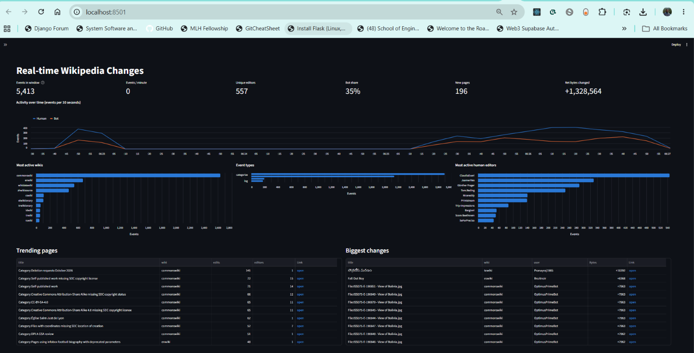

# Wikipedia Live Changes: Pub/Sub → MongoDB → Streamlit

A small real-time data pipeline. It streams edits from the Wikimedia "recent changes" feed, passes them through Google Cloud Pub/Sub, stores them in MongoDB, and shows them on a live Streamlit dashboard.



## Architecture

```
Wikimedia SSE stream
        │
        ▼
  wiki_pub.py        publishes each event to the Pub/Sub topic `wiki-topic`
        │
        ▼
Google Cloud Pub/Sub  (topic: wiki-topic, subscription: wiki-topic-sub)
        │
        ▼
  wiki_sub.py        transforms each event and inserts it into MongoDB
        │
        ▼
MongoDB Atlas        database `wiki`, collection `changes`
        │
        ▼
 wiki_display.py     Streamlit dashboard that queries MongoDB
```

| File | Role |
|------|------|
| `wiki_pub.py` | Connects to `https://stream.wikimedia.org/v2/stream/recentchange` (with exponential-backoff reconnects) and publishes each event as JSON to Pub/Sub. |
| `wiki_sub.py` | Pulls messages from the subscription, flattens them into a clean document (`id`, `type`, `wiki`, `title`, `user`, `bot`, `byte_change`, `url`, ...), adds a `received_at` UTC timestamp, inserts the document into MongoDB, then acks the message. |
| `wiki_display.py` | Streamlit dashboard. Each refresh loads the events inside the selected time window from MongoDB and renders KPIs, charts and tables. |
| `exp.ipynb` | Scratch notebook for experiments. |

## Why Pub/Sub instead of writing straight to MongoDB?

For a single stream and a single destination, a direct insert would be simpler. Pub/Sub sits in the middle for these reasons:

- **Decoupling.** The publisher doesn't depend on MongoDB. If the database is slow, down, or unreachable (for example, an Atlas IP allowlist problem), the publisher keeps running.
- **Buffering and durability.** Unacknowledged messages are kept (7 days by default), so you can stop and restart the subscriber without losing events. The Wikimedia stream is live-only, so events missed by a direct writer are gone for good.
- **Retries.** If the subscriber callback fails, the message isn't acked and is redelivered.
- **Fan-out.** More consumers (for example BigQuery, alerts, or ML processing) can be added as extra subscriptions without touching the publisher or the MongoDB writer.
- **Scaling.** Several subscriber processes can share one subscription to split the load.
- **Absorbing bursts.** The queue smooths out spikes in the feed so writes can catch up.


## Dashboard features

- KPIs: events in window, events per minute, unique editors, bot share, new pages, net bytes changed
- Activity over time, split into human and bot edits
- Most active wikis, event types and human editors
- Trending pages and biggest changes (with links to the pages)
- A live "Latest changes" feed
- Sidebar filters: time window, include or exclude bots, event types, wiki name, refresh interval

## Prerequisites

- Python 3.10 or later
- A Google Cloud project with the Pub/Sub API enabled, and a service account key with Pub/Sub permissions
- A MongoDB database (a free [MongoDB Atlas](https://www.mongodb.com/atlas) cluster works). If you use Atlas, add your current IP under **Security → Network Access**.

## Setup

```bash
python -m venv .venv
.venv\Scripts\activate          # Windows
# source .venv/bin/activate     # macOS / Linux
pip install -r requirements.txt
```

Create a `.env` file in the project root (it is git-ignored):

```env
GOOGLE_APPLICATION_CREDENTIALS=path/to/your-service-account-key.json
MONGODB_URI=mongodb+srv://<user>:<password>@<cluster>.mongodb.net/
```


The subscription `wiki-topic-sub` is created by `wiki_sub.py` if it is missing. The project ID, topic and subscription names are set at the top of `wiki_pub.py` and `wiki_sub.py`. Change them to match your own project.

## Running

Start each component in its own terminal, with the virtual environment activated:

```bash
python wiki_pub.py
```

```bash
python wiki_sub.py
```

```bash
streamlit run wiki_display.py
```

Then open <http://localhost:8501>.

The dashboard only shows data while the publisher and subscriber are running, because it reads whatever they have written to MongoDB.


